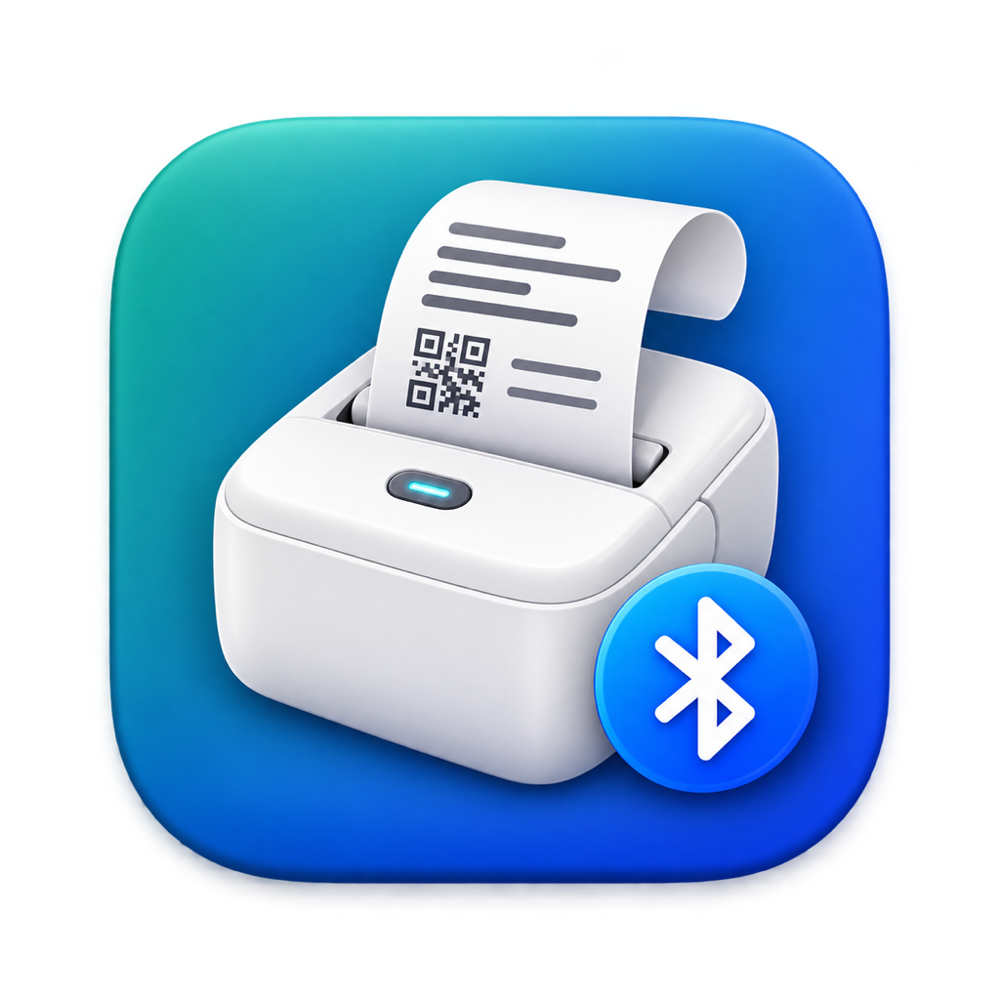

<p align="center"></p>

# S1Print: Mac driver for the Luck Jingle S1 Bluetooth thermal printer

**Print receipts, tickets and labels from your Mac to a Luck Jingle S1 mini thermal printer over Bluetooth.** It works from Chrome, Safari, Preview or any app, with no vendor driver. Free, open source and notarized by Apple.

[Download S1Print](https://github.com/MarvinQuevedo/s1print/releases/latest) (Mac, Windows, Android) · Developed by [Marvin Quevedo](https://github.com/MarvinQuevedo) · Brought to you by [Facta DTE](https://www.factadte.com)

> **Built for [Facta DTE](https://www.factadte.com)**, electronic invoicing (DTE) for El Salvador. S1Print started as the way to print Facta DTE counter tickets on a pocket Bluetooth printer. If you issue facturas, créditos fiscales or tickets in El Salvador, Facta DTE signs and sends them to the Ministerio de Hacienda from your browser, keeps your documents in your own storage, and prints the ticket on this printer. Free plan available at [factadte.com](https://www.factadte.com).

## Is this for you?

You probably found this page because:

- your Mac **pairs the printer** (it shows up as `PPS1_XXXX`, often with a **keyboard icon**) but it **never appears in Printers & Scanners**;
- Luck Jingle offers a phone app and drivers for its A4 models, but **no Mac driver for the S1**;
- you want to print a **58 mm receipt or ticket** (a POS ticket, an invoice, a label) from a web page or a PDF on your Mac.

S1Print fixes that. It adds a normal printer called **S1 Bluetooth** to macOS. Pick it in any print dialog and the ticket comes out of the S1.

## Install in three steps

1. **Pair the printer**: turn it on, then System Settings → Bluetooth → connect `PPS1_XXXX`.
2. **Install S1Print**: download the zip from [Releases](https://github.com/MarvinQuevedo/s1print/releases/latest), unzip it, move **S1Print.app** to Applications and open it. Allow Bluetooth when macOS asks.
3. **Print**: choose **S1 Bluetooth** in the print dialog and the **58x600mm** paper size (the 58 mm roll). The menu-bar icon can print a test page.

Requires macOS 13 Ventura or later. Releases from 0.3.4 on are signed with a Developer ID and notarized, so macOS opens them normally.

## What you get

- A driverless printer for every app: Chrome, Safari, Preview, Word, POS and invoicing web apps.
- Paper sizes for the S1: a **58 mm roll** with the blank space trimmed automatically, **80 mm** receipts scaled down, and a custom size for labels (58 × 30 mm and up).
- Sharp small text and QR codes: the printer asks apps for 406 dpi, fits the content to the 48 mm head and keeps thin strokes black.
- A menu-bar app that shows battery and paper status, prints a test page, adds or removes the printer, and has a Settings window (darkness, printer name, open at login, network sharing).
- Private by default: the print server listens on your Mac only, unless you turn on sharing.

## Compatibility

| Printer | Status |
|---|---|
| Luck Jingle **S1** (`S1_LYiN48D_GY`, firmware V3.0.3), 56–58 mm paper | Tested |
| Other Luck Jingle / LuckPrinter "Lujiang" models (names like `PPS1_`, `S1_`, `LuckP`) | Untested. They may work; please [open an issue](https://github.com/MarvinQuevedo/s1print/issues/new) with your model |
| Printers that use the Luck Jingle app under other brands | Untested. The command set is shared by the LuckPrinter family, but start/stop commands and head width vary |
| Windows, Android | Native apps on the shared Rust core, in [Releases](https://github.com/MarvinQuevedo/s1print/releases/latest): Windows installer and Android APK (debug-signed preview). [Details](docs/NATIVE_PLATFORMS.md) |
| iOS / iPadOS | Native app over Bluetooth Low Energy, tested on an iPhone with the S1. Not on the App Store yet: build it from source ([docs/IOS.md](docs/IOS.md)) |
| Linux | Rust core only; native printer application remains planned: [docs/CROSS_PLATFORM.md](docs/CROSS_PLATFORM.md) |

## FAQ

### Why doesn't my Bluetooth thermal printer show up in Printers & Scanners?
macOS only adds a Bluetooth printer by itself when it speaks the Bluetooth printing profile (HCRP). Mini thermal printers like the S1 only speak a serial port profile (SPP). The Mac can pair them but cannot print to them without software such as S1Print.

### Why does the printer show a keyboard icon in Bluetooth settings?
It is a generic icon macOS uses for devices it does not classify. It is harmless.

### How do I print a receipt or ticket from Chrome or Safari?
Choose **S1 Bluetooth** and the **58x600mm** paper size. In Chrome, set Margins to **None** and turn off headers and footers. In Safari, save the size as a preset (Presets → Save Current Settings as Preset) so you don't pick it every time.

### The print is too small. What can I do?
Use the 58 mm roll size, not Letter or A4. If a web page lays the receipt out wider than 58 mm, the browser shrinks it; S1Print crops empty margins and fills the head, but the page itself sets the font size.

### Does it work over Bluetooth Low Energy (BLE)?
On iOS, yes: iPhones cannot use classic Bluetooth serial, so the iOS app speaks the S1's BLE service with its credit-based flow control. Mac, Windows and Android use classic Bluetooth (SPP). Other BLE "cat printers" are untested.

### Where are the hard-won lessons?
[docs/FIELD_NOTES.md](docs/FIELD_NOTES.md) collects what went wrong on each platform and what fixed it: blank bands over BLE, jobs that never finished, overlapping lines, and how web tickets should be printed.

### Is it safe?
The source code is public, the app is notarized by Apple, and the print server only accepts jobs from your own Mac unless you enable sharing.

## Settings

Menu-bar icon → **Settings…** (⌘,), or open the app again:

| Setting | Default | What it does |
|---|---|---|
| Bluetooth printer | Automatic | Pick one paired S1 when you have several |
| Darkness | Medium | Light, medium or dark printing |
| Fit content to paper width | On | Crop empty side margins and fill the 48 mm head |
| Printer name | S1 Bluetooth | Name shown in print dialogs |
| Installed in macOS Printers | On | Add or remove the print queue |
| Open at login | Off | Start S1Print when you log in |
| Share on the local network | **Off** | Off: the print server listens on this Mac only. On: other devices on your network can find and use the printer |

Settings live in `~/Library/Application Support/s1print/settings.json`.

## Command line

The CLI runs through the app bundle, for the Bluetooth permission; `scripts/s1print` does that:

```bash
scripts/s1print status                       # model, battery, paper
scripts/s1print test                         # test page
scripts/s1print print ticket.pdf --density 2 # PDF, PNG, JPEG, PWG/URF raster
scripts/s1print preview ticket.pdf out.png   # what would be printed, no Bluetooth
```

## Build from source

```bash
./scripts/bundle.sh                 # builds build/S1Print.app (Swift 5.10+, Xcode)
cp -R build/S1Print.app /Applications/
open /Applications/S1Print.app
```

`bundle.sh` signs with your first "Apple Development" identity (or `SIGN_IDENTITY`), so the Bluetooth permission survives rebuilds. `scripts/release.sh` signs with a Developer ID, notarizes and staples.

## Rust core development

An additive, platform-independent Rust implementation of the print pipeline is
available in `rust/s1-core`. The Mac app still uses Swift. A differential runner
compares both implementations case by case and exports images and command bytes
for review. See [docs/RUST_CORE.md](docs/RUST_CORE.md) for commands, coverage and
platform integration boundaries.

## How it works

```
App ─► CUPS queue "S1 Bluetooth" (IPP Everywhere, no driver)
    ─► ippeveprinter on 127.0.0.1 (ships with macOS, started by S1Print.app)
    ─► s1print: decode Apple/PWG raster → fit to 384 dots → black and white → S1 commands
    ─► Bluetooth RFCOMM ─► S1
```

- [docs/PAPER.md](docs/PAPER.md): the whole design and every problem found on paper, with its fix.
- [docs/PROTOCOL.md](docs/PROTOCOL.md): the S1 command set.
- [docs/FIELD_NOTES.md](docs/FIELD_NOTES.md): lessons from every platform, in one page.
- [docs/LUCKPRINTER_SDK.md](docs/LUCKPRINTER_SDK.md): what the vendor app does, and how we found out.

Thanks to [fichero-printer](https://github.com/0xMH/fichero-printer) for documenting the LuckPrinter command family.

## Made by the Facta DTE team

S1Print is free and stays free. It is maintained by the people behind
[Facta DTE](https://www.factadte.com), electronic invoicing for El Salvador:
Factura, Crédito Fiscal, Exportación, Sujeto Excluido and the rest of the DTE
catalogue, signed in your browser and sent to the Ministerio de Hacienda, with
your documents stored where you choose. Look for us as **Facta DTE**.

## License

MIT. Not affiliated with Luck Jingle or Xiamen Lujiang Technology Co., Ltd. "Luck Jingle" is used only to name the printer this software works with.
